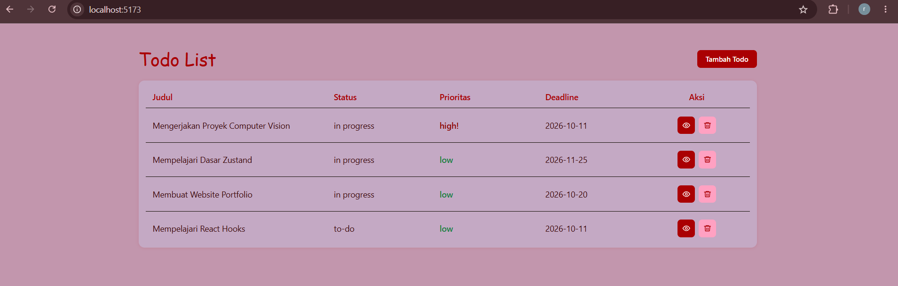
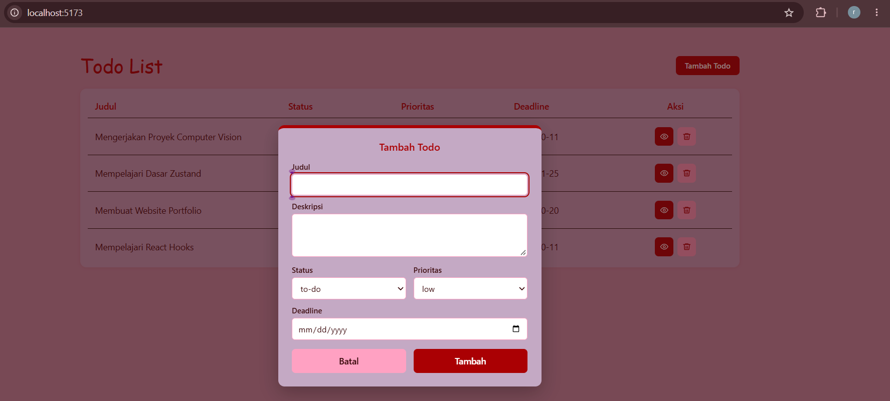
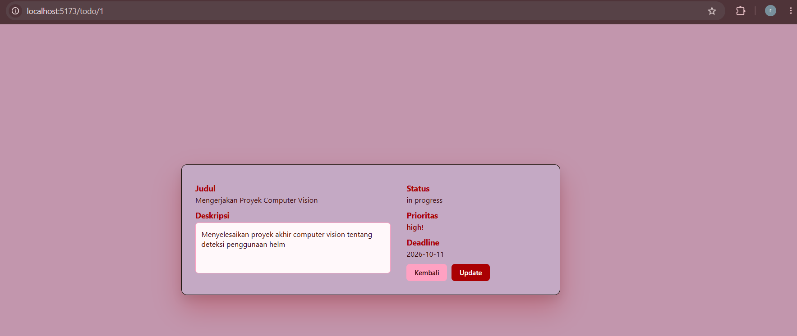
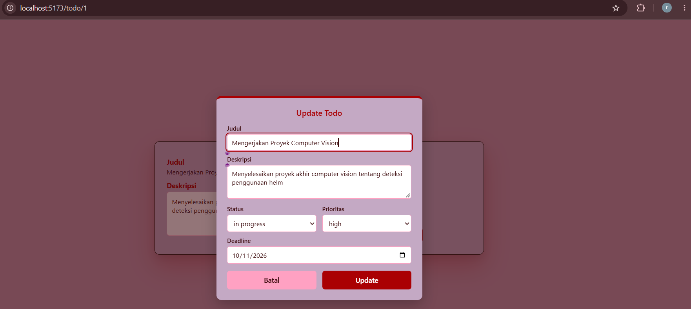
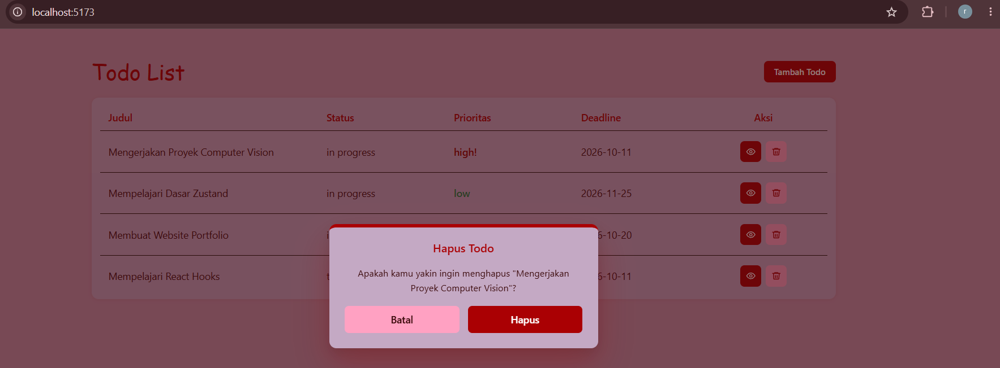

# Todo List – React.js

Aplikasi To-Do List (frontend only) Kuis Praktikum Pemrograman Web

## Fitur
- Menampilkan daftar tugas (judul, status, prioritas, deadline)
- Melihat detail tugas (`/todo/:id`)
- Menambah tugas lewat modal formulir (dengan validasi)
- Memperbarui tugas lewat modal formulir
- Menghapus tugas dengan konfirmasi + notifikasi 
- Perubahan langsung tampil tanpa reload halaman

## Menjalankan
```bash
npm install
npm run dev
```
Buka http://localhost:5173

## Screenshot

| Daftar Todo | Tambah Todo |
|---|---|
|  |  |

| Detail Todo | Update Todo |
|---|---|
|  |  |

| Konfirmasi Hapus |
|---|
|  |
